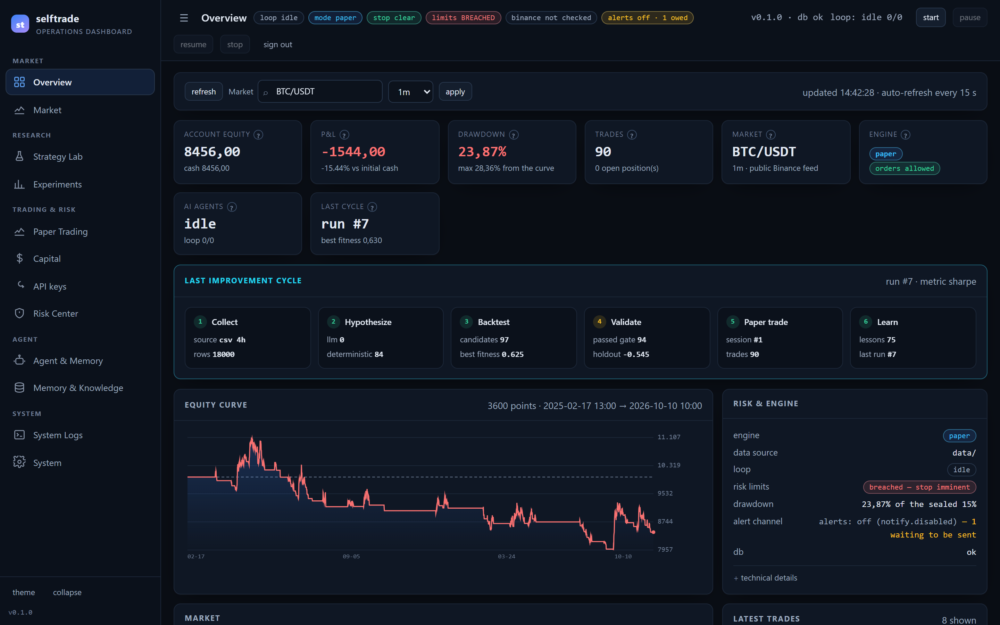
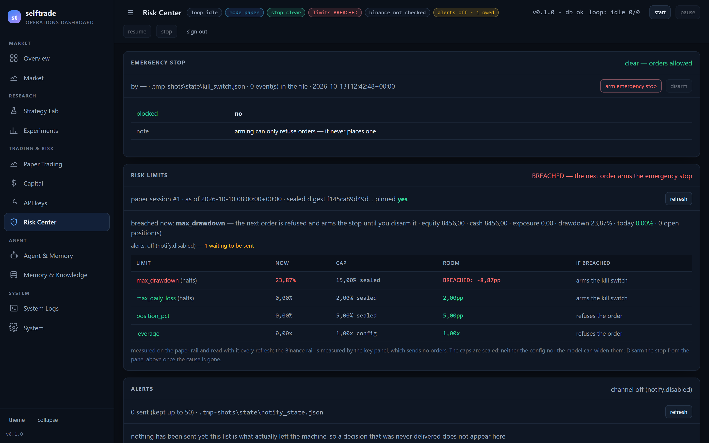
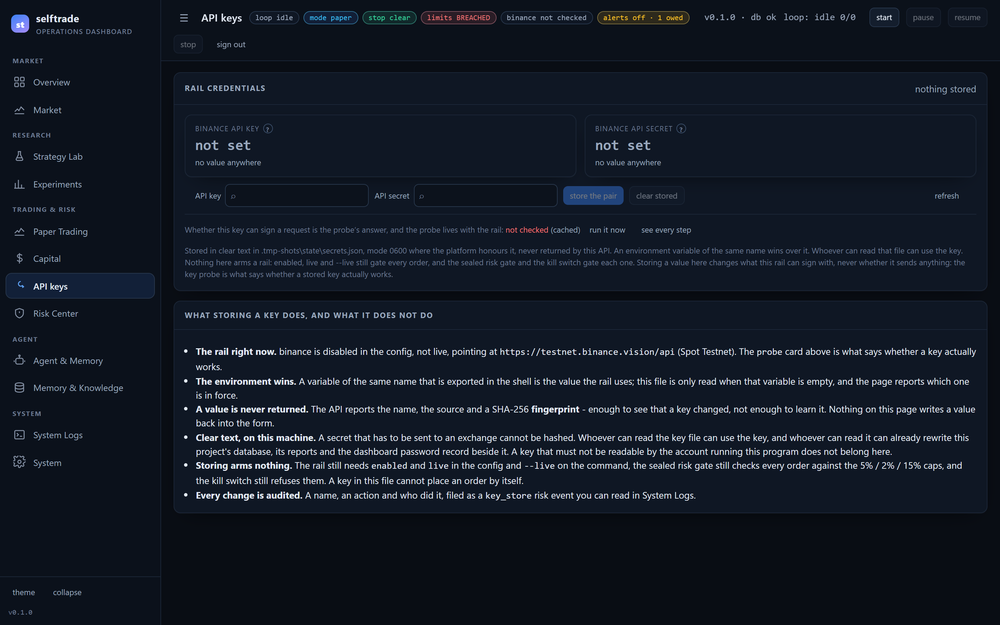
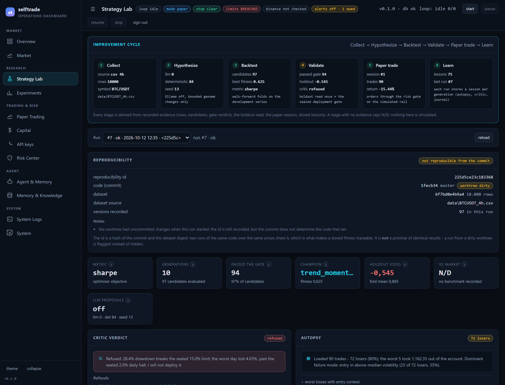
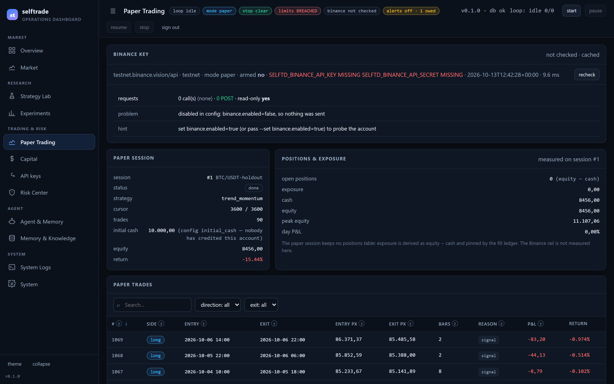
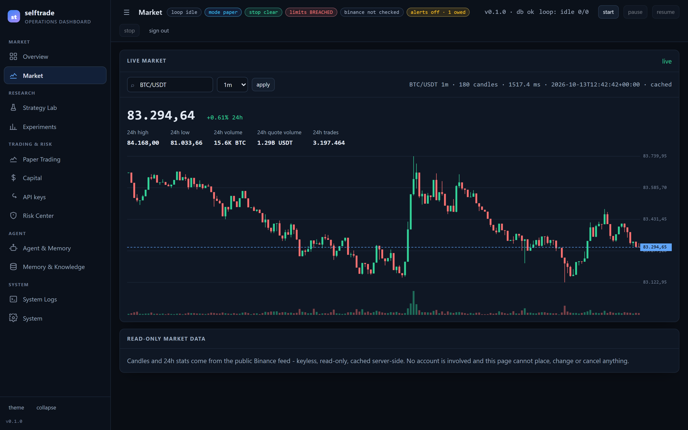

# Dashboard

A dashboard served by the Python standard library: a **login**, a **live Binance
chart**, a **Binance key panel**, an **emergency stop**, a **risk-limits panel**, the
**loop controls** (which start and steer the tracked loop for real) and the bot panels.

## What it looks like

These are real captures of a running server on `127.0.0.1`, rendering a copy of this project's
own `state/selftrade.db` — 7 runs, 592 candidates, one paper session with 90 trades and 105
strategy versions. Nothing below is a mock-up, and the numbers on screen are the ones
[`../docs/VERIFICATION.md`](VERIFICATION.md) records:

| | |
| --- | --- |
|  |  |
| **Overview** — equity, the drawdown against the sealed cap, the six-stage cycle, the equity curve | **Risk Center** — the emergency stop and the limits it answers to |
|  |  |
| **API keys** — where each credential comes from, and the one write on the page | **AI Lab** — the cycle, the reproducibility record, the critic and the version history |
|  |  |
| **Paper Trading** — the forward session and the read-only key probe | **Market** — keyless public candles, and no key to leak |

To reproduce a capture: start the server against a database you are willing to have read, then
open the page at `1440×900` with the sidebar expanded. `docs/img/` is where they live, and
regenerating them is expected when a page changes — a stale screenshot is a small lie.

```powershell
.\dashboard.ps1
# or: python -m selftrade serve --host 127.0.0.1 --port 8787
# LAN (phone on the same Wi-Fi): the login is mandatory
.\dashboard.ps1 -BindHost 0.0.0.0
```

There are **no remote assets and no third-party scripts** — the page is a single
inline HTML document. The live data comes from Binance's **public** mirror
(`data.fetch_base_url`, `https://data-api.binance.vision`): keyless, read-only,
the same client `data --fetch` uses.

## Login

`dashboard.auth` is **on by default** and is **required** for any bind that is not
loopback: opening the loop controls on the LAN without a password is a mistake the
code refuses to make (the config rejects it, and `make_server` refuses it again).

Two places can hold the password, and the environment wins:

1. **`dashboard.password_env`** (default `SELFTD_DASHBOARD_PASSWORD`) — the *name* of an
   environment variable. The value is never written to `config.yaml`, never logged and
   never returned by the API. When it is set it **overrides** the stored password, because
   a machine that provisions dashboards from the environment must not be surprised by a
   change made in a browser — so the Settings card *refuses* to change it and says which
   variable is in charge, rather than writing a hash nothing would read;
2. **`dashboard.password_file`** (default `state/dashboard_auth.json`) — where a password
   set from the dashboard is stored, as a **salted PBKDF2-HMAC-SHA256 hash** (240 000
   rounds, a fresh salt per change) and nothing else. The file is written atomically and
   owner-only; the password itself is never in it, in a log or in a response.

**The first login is `0000`.** Nothing is stored until someone changes it, so a fresh
install is usable without ceremony, and the server says so at startup:

```
selftrade dashboard on http://127.0.0.1:8787  (Ctrl+C to stop)
  login: the DEFAULT password is in use (0000) - change it under Settings in the dashboard, or with `python -m selftrade password --set`
  (nothing is stored yet: it will be written to state/dashboard_auth.json as a salted hash)
```

Change it in **Settings → Login password** (current password, new password twice, then an

explicit confirmation), and the banner that says the bootstrap password is in use
disappears. Changing it **signs out every other session**: the cookie is signed with a
key this process rotates, so the change is real and not just a new string to type. The
session that made the change is re-issued a fresh cookie in the same response.

The environment variable remains the path for a machine that should never be changed from
a browser:

```powershell
$env:SELFTD_DASHBOARD_PASSWORD = "a-long-passphrase"
.\dashboard.ps1 -BindHost 0.0.0.0
```

### If you forget it

```powershell
python -m selftrade password status     # where the password comes from, never what it is
python -m selftrade password set        # prompts twice (--value "…" skips the prompt)
python -m selftrade password reset --confirm   # forget it: back to the bootstrap 0000
```

The CLI is an escape hatch, and an honest one: a shell on this machine can already rewrite
the state directory, so asking it for permission would be theatre. What it will not do is
guess — it applies the same length rule as the page (`dashboard.password_min_length`,
default 4) and writes only the hash.

**The trust boundary, stated plainly:** whoever can write this file owns the dashboard —
deleting it, or corrupting it, decides who can sign in. That is not a bug to paper over
but the reason the file lives in the state directory next to the database it protects. A
*corrupt* file fails **closed** (every password is refused and the page says so) rather
than falling back to `0000`; deletion is the documented way back to the bootstrap value.

**The session** is a signed cookie: `st_session=<issued>.<hmac>`, `HttpOnly`,
`SameSite=Strict`, `Path=/`, TTL `dashboard.session_ttl_s` (default 24 h). The
signing key is generated per process, so restarting the server invalidates every
session and nothing has to be stored on disk. A wrong password is answered with
`401`; more than 8 failures from the same address in 5 minutes with `429`.

Boundary, stated plainly: there is **no server-side revocation list**. `logout`
clears the browser's cookie, but a *copied* token stays valid until its TTL — this
is a local dashboard, not an identity provider. Changing the password is the one way to
invalidate every session at once, because it rotates the signing key. Reach the
dashboard from outside with a reverse proxy and TLS, or a tunnel, not by exposing the
port.

## The live chart

The **Live market** panel draws real candles (open/high/low/close + volume) on a
`<canvas>` and redraws every `dashboard.market_refresh_s` (default 3 s): the last
candle grows and the price line moves. Symbol and interval (1m…1d) are selectable
in the page; defaults come from `dashboard.market_symbol` / `market_interval` /
`market_bars`.

It lives on the **Market** page, which also prints the 24h strip under the price: the
last price and its 24h change, then the feed's own high, low, base volume, quote volume
and trade count. Volumes and counts are compacted for the eye (`15.3K BTC`, `1.27B
USDT`) with the exact figure in the cell's tooltip — the number the feed sent is always
recoverable, and a ticker that did not arrive reads `N/D` rather than a zero.
The same series is drawn on the Overview's smaller panel: one selection, two places it is
shown, and the *apply* button moves both.

`GET /api/market?symbol=BTC/USDT&interval=1m&bars=180` returns:

```json
{"ok": true, "symbol": "BTC/USDT", "interval": "1m",
 "source": "https://data-api.binance.vision",
 "candles": [{"t": 1710000000000, "o": 1.0, "h": 2.0, "l": 0.5, "c": 1.5, "v": 10.0}],
 "ticker": {"last": 6.5, "change_pct": 0.055, "high": 7.0, "low": 0.5, ...},
 "fetched_at": "…", "latency_ms": 41.2, "cached": false}
```

A network failure is **returned, never raised**: `ok: false` with the reason, so a
chart cannot break the dashboard. Responses are cached for `min(2 s, refresh)` so
many open tabs do not turn into a request flood. With no keys configured, this is
market data only — the Binance **Testnet** order rail stays behind its own
two-key gate (`docs/BINANCE-TESTNET.md`).

## The Binance key panel

The **Binance key** panel answers, while you watch, the question a new operator
asks first: *is this key actually usable?* It is not a second implementation — the
server calls the same `key_health` the CLI's `binance check` calls, so the panel and

```powershell
python -m selftrade binance check
```

report exactly the same thing: the clock and its offset, the signature, the account
permissions (`canTrade`, `canWithdraw`, `permissions`), the balances, the open
orders, the rate budget and the POST count. It refreshes every
`dashboard.key_refresh_s` (default 60 s) and the same value is the server-side cache
window, so many open tabs still cost **one probe per minute**.

What the panel *cannot* do is send anything. The probe builds the adapter **unarmed**
(`live=False`, no gate, no kill switch needed because nothing is sent) and the report
carries the exchange's own request count, so "0 POST" is evidence in the payload and
not a promise. The only button is **recheck**, which forces the probe to run again
before the window expires.

When there is nothing to ask, the panel says so rather than going blank:

| State | What you see |
| --- | --- |
| `binance.enabled: false` | verdict `not checked`, reason *disabled in config*, the hint that turns it on |
| credentials not exported | the same, naming `SELFTD_BINANCE_API_KEY` / `SELFTD_BINANCE_API_SECRET` (the values are never read back or printed) |
| production host not opted into | verdict `not checked`, the reason, and `PRODUCTION` in red |
| key refused by Binance | the failing step, the error code, the documented next step |
| everything fine | `ok`, permissions, balances, open orders, `ready to trade` |

`GET /api/binance` returns that report plus `latency_ms`, `cached` and `refresh_s`.
It is JSON-only from the browser but a normal `curl` call works too:

```powershell
curl.exe -b cookies.txt http://127.0.0.1:8787/api/binance
curl.exe -b cookies.txt "http://127.0.0.1:8787/api/binance?force=1"   # recheck now
```

The panel needs `binance.enabled: true` to reach the exchange and **never** needs
`binance.live`: the two arming keys of the order rail (`binance.live` +
`--live`) do not apply here, because this path cannot place an order.

## The API keys page

Every other secret in this project is addressed by the **name** of the environment
variable that holds it — `config.yaml` carries the names, never the values. The rail's
key pair is the one credential that has to be typed somewhere, so it has a page.

**What it shows.** One tile per credential (`SELFTD_BINANCE_API_KEY`,
`SELFTD_BINANCE_API_SECRET`, i.e. whatever `binance.api_key_env` / `api_secret_env`
say), each with three things: whether a value is set, **which source is in force**
(`from the environment (wins)` or `from the local key file`) and a SHA-256
**fingerprint** — enough to see that a key changed, not enough to learn it. The rail's
own switches (`enabled`, `live`, the host, and whether it is the Testnet one) are listed
with them, because a key arms nothing.

**What it writes.** `POST /api/keys` stores or forgets one of those names in
`binance.key_file` (`state/secrets.json` by default, which `.gitignore` keeps out of the
repository), written atomically and owner-only (`0600` where the platform honours it) —
the same discipline the dashboard password uses. It is a write, so it needs
`confirm: true` in the body *and* a confirmation on the page, and it is filed as a
`key_store` `risk_events` row naming the credential and the action. **No method of the
API ever returns a value**, the names are the rails' own rather than free-form, and a
corrupt store resolves every name to nothing (the rail refuses to arm) instead of
failing quietly.

The page states the two things a reader needs to know:

* **the environment still wins.** A value exported in the shell is the one the rail
  uses; the file is only read when that variable is empty, and the tile says which one
  is in force. "Clear stored" removes the value **you** stored — it cannot and does not
  touch a variable of the same name.
* **the file is clear text.** An API secret has to be *sent* to the exchange, so it
  cannot be hashed the way the dashboard password is. Whoever can read that file can
  use the key — and whoever can read it can already rewrite this project's database, its
  reports and the password record beside it. A key that must not be readable by the
  account running this program does not belong in it.

```powershell
curl.exe -b cookies.txt http://127.0.0.1:8787/api/keys
curl.exe -b cookies.txt -X POST http://127.0.0.1:8787/api/keys -H "Content-Type: application/json" -d "{\"action\":\"set\",\"name\":\"SELFTD_BINANCE_API_KEY\",\"value\":\"...\",\"confirm\":true}"
```

Whether a stored key *works* is still the probe's answer, and the probe keeps living
with the rail on **Paper Trading**: this page shows its last verdict and offers *run it
now* and *see every step* rather than a second copy of the same card.

```powershell
# the page writes the file the CLI and the rail already read, in another process
python -m selftrade binance check --set binance.enabled=true
```

## The emergency stop

The **Emergency stop** card sits at the top of the page, answers "are new orders
allowed right now?", and is the only thing on this page that **writes**.

It flips the **same file** (`state/kill_switch.json`) that the risk gate, the paper
loop and the Binance adapter consult before every order, so one click stops orders on
every rail at once, and the state outlives the server *and* the bot — `switch show`
reads the very switch the browser set. It is offered here precisely because of what it
cannot do: arming **refuses** orders, it never places, changes or cancels one.

| Button | What it writes |
| --- | --- |
| **arm emergency stop** | `blocked: true`, your reason, `triggered_by: dashboard` — every new order is refused from then on |
| **disarm** | `blocked: false` — new orders are allowed again, with the same audit trail |

When the **program** armed the stop (the paper rail, on a sealed-limit alert) the card
shows one extra row per halting limit — `at arming · max_drawdown 23.87% of the 15.00%
cap — 8.87pp past it` — from the `detail` the switch keeps for exactly that reason: the
margin at the refusal cannot be recomputed afterwards. An operator's own arm has no such
row, because there was no refusal to report, and the JSON carries `detail: {}` (see
`docs/NOTIFICATIONS.md` for the alert that carries the same numbers).

Both directions ask for a **reason** and a second, explicit click, and the server
refuses any POST without `confirm: true`, so a stray `curl`, a replayed cookie or a
script cannot flip the switch behind your back. Until the first read lands **both
buttons are disabled**: an unknown stop state is not actionable either way.

Each action is recorded twice, on purpose: in the switch's own bounded `history`
(what `switch show` prints) and as a `risk_events` row of kind `kill_switch` — the
table every other risk decision lands in. The card lists the last five events, and
the line under the buttons reports what became of the *last* click, including
`armed — but NOT recorded in risk_events: …` when the database could not be written:
**the switch file is the control** and a locked database must not be able to defeat
it, but the missing audit row is never hidden either.

The state is read with the panels (every `dashboard.auto_refresh_s`, default 15 s) and
again immediately after every action — never on the slower `key_refresh_s` window,
because a stop state that lags is worse than no state at all.

```powershell
curl.exe -b cookies.txt http://127.0.0.1:8787/api/killswitch
curl.exe -b cookies.txt -X POST http://127.0.0.1:8787/api/killswitch -H "Content-Type: application/json" `
  -d "{\"action\":\"arm\",\"reason\":\"stopping new orders before the weekend\",\"confirm\":true}"
```

## The risk limits

The **Risk limits** card sits directly under the emergency stop, because it answers
the question the stop makes urgent: *how close is the gate to engaging it?* It shows
the account measured against the **sealed** caps (`docs/EXECUTION-AND-RISK-GATE.md`) and
the **room left** under each one.

| Limit | Cap | Source | If it is breached |
| --- | --- | --- | --- |
| `max_drawdown` | 15.0% | sealed | **arms the kill switch** |
| `max_daily_loss` | 2.0% | sealed | **arms the kill switch** |
| `position_pct` | 5.0% of equity, per position | sealed | refuses the order that would break it |
| `leverage` | `risk_gate.max_leverage` | config | refuses the order that would break it |

The two account limits are marked `(halts)` because a breach puts an alert on the
decision and the paper rail arms the stop on that alert; the other two only refuse one
order and leave the rail running. The card colours the nearest limit, names it in the
headline, and prints the number that matters — `room` in percentage points of equity
(or x-equity for leverage), negative once the cap is passed.

The numbers are **not recomputed in the page**. The panel hands the account to the
gate's own limit functions (`selftrade.execution.account_limits` /
`exposure_limits`), so the table cannot report a limit the gate enforces differently —
`tests/test_dashboard.py` asserts the two agree, value for value, on the same account.

Where the account comes from, and what is therefore *not* in the panel:

* **drawdown** is the active paper session's equity curve against its own running peak
  — the measure `PaperBroker` takes, reconstructed from `paper_equity`;
* **today's P&L** is that curve's last point against the first point of the same UTC
  date, which is the broker's own day boundary;
* **exposure** is `equity - cash` on the session: the rail marks its open position
  inside that difference, and the session keeps no positions table;
* with **no session** there is nothing to measure, and the panel says so — it shows no
  rows rather than four zeros, because a limits panel that cannot see an account must
  not look like a clean bill of health;
* the **Binance rail is not measured here**: reading it means signed requests against
  the exchange's rate budget, and that is the key panel's job.

It is one database read and **no writes at all** — no file is sealed, no switch is
armed, no audit row is added (`tests/test_dashboard.py` asserts exactly that). Read
with the panels every `dashboard.auto_refresh_s`, never on the slower key window.

The card also carries two chips about the alert channel, because a red row nobody has
been told about is the one row worth acting on:

* the **channel**: `alerts: telegram ready`, `alerts: off (notify.disabled)` — a choice —
  or `alerts: ENABLED but env SELFTD_TELEGRAM_TOKEN is not set`, which is a mistake;
* the **debt**: `— N waiting to be sent`, the same list `python -m selftrade notify
  status` prints (the payload's `pending`), including the `past`-band warning for a
  breach nothing has stopped yet. Asking for it consumes nothing: the panel never sends
  and never writes the ledger (`tests/test_dashboard.py` asserts both, twice in a row).

The channel itself, its bands and its ledger are in `docs/NOTIFICATIONS.md`.

```powershell
curl.exe -b cookies.txt http://127.0.0.1:8787/api/risk
```

```json
{"ok": true, "pinned": true, "sealed": true, "would_arm": false,
 "session": {"session_id": 1, "points": 3600, "as_of": "2026-10-10 08:00:00+00:00"},
 "account": {"equity": 8456.0, "cash": 8456.0, "positions_value": 0.0,
             "peak_equity": 11107.06, "drawdown_pct": 23.87, "day_pnl_pct": 0.0},
 "checks": [{"name": "max_drawdown", "value": 23.87, "limit": 15.0, "ok": false,
             "headroom": -8.87, "unit": "pp", "source": "sealed",
             "arms": true, "effect": "arms the kill switch", "alert": "…"}],
 "breached": ["max_drawdown"], "nearest": {"name": "max_drawdown", "headroom": -8.87},
 "alerts": {"ready": false, "reason": "notify.disabled", "channel": null,
            "token_env": "SELFTD_TELEGRAM_TOKEN", "warn_below_frac": 0.25},
 "pending": [{"kind": "warning", "reason": "max_drawdown", "band": "past",
              "headline": "selftrade WARNING - max_drawdown is past its cap: "
                          "the next order arms the stop"}]}
```

## The alerts card

The **Alerts** card sits under the risk limits, because it answers the question that
follows every red row there: *was anybody told, and what exactly did they read?* It reads
the alert channel's own ledger (`docs/NOTIFICATIONS.md`) and lists what went out, newest
first:

| Column | Meaning |
| --- | --- |
| **when** | the moment the message actually left (`notify`'s own timestamp) |
| **kind** | `HALT (automatic)` (the program armed the stop), `HALT (by you)` (you did), or `warning` |
| **why** | the limit that caused it — with `[close]`/`[past]` for a warning band |
| **what was said** | the first line of the message, as sent |

The header carries the channel's readiness — `channel ready`, `channel off
(notify.disabled)`, or the reason it cannot send — and the line under it counts the
history (`2 sent (kept up to 50)`) and names the ledger file. A **halt the program armed**
is the row that matters at three in the morning: nobody was at the screen when it
happened, and this is the only place that says so in one line.

Only *delivered* notices are ever written to the ledger, so this card cannot show a
message that never left the machine — and a message that failed stays absent until a
later round delivers it. Reading it costs one file read and writes nothing, and it is
refreshed with the panels, right after the limits it belongs to.

```powershell
curl.exe -b cookies.txt http://127.0.0.1:8787/api/alerts
```

```json
{"ok": true, "sent": 2, "limit": 50, "state_file": "state/notify_state.json",
 "channel": {"ready": false, "reason": "notify.disabled", "channel": null},
 "items": [{"at": "2026-10-11T14:48:08+0200", "kind": "halt", "band": null,
            "automatic": true, "reason": "…drawdown 23.87% breaks the sealed 15.0% limit…",
            "headline": "selftrade HALT (automatic) - the gate stopped trading, not you"},
           {"at": "2026-10-11T14:48:08+0200", "kind": "warning", "band": "past",
            "automatic": null, "reason": "max_drawdown",
            "headline": "selftrade WARNING - max_drawdown is past its cap: …"}]}
```

A `notify reset` (the CLI) re-arms the deduplication and **keeps** this history: a reset
is not a way to rewrite what was sent.

## The loop controls

The header carries **start · pause · resume · stop · logout**, and they act on a
process, not on a hope. **`start` runs the tracked loop** —
`python -m selftrade evolve --session`, the only thing that honours
`state/session.json` — as a child of the dashboard, detached (its own process group on
Windows, its own session on POSIX) so a run outlives the page and a `Ctrl+C` in the
dashboard's console does not take a generation down mid-flight. Its pid is written into
the session file, its output goes to `state/loop.log`, and the answer to the click is
that pid + command, not a promise.

`pause`, `resume` and `stop` are delivered through the session file, which the loop
reads at every generation boundary — a pause really blocks there, and a stop lets the
run finish the generation it is in and still write its report. Two processes edit that
one file, so every write is a locked read-modify-write: without it the loop could write
back the heartbeat snapshot it read *before* your `stop` arrived, and the click would do
nothing (see `Session._locked` in `selftrade/session.py`). With **nothing running
they are refused with `409`** and *nothing is written*: a request in a file no process
reads is how a control panel looks responsive and does nothing, so the panel says
`no loop is running` instead.

The buttons follow the state, not the click: `start` is offered only when nothing runs,
`pause`/`resume`/`stop` only when something does, `resume` only while the loop is
paused (or a pause is on its way), and every one of them is disabled until the first
read lands — an unknown loop state is not actionable either way. The line next to the
buttons is the loop's own truth: `loop: running 3/12 · pid 41208`, what came back from
the last click, or the reason it was refused.

Two sources are read and can disagree: the session file is the *record* (any loop,
wherever it was started) and the pid decides whether anything is behind it. A file that
still says `running` while its pid is gone is reported as **not running** — a crashed
loop is not a running one.

Stopping the dashboard does **not** stop the loop, on purpose: a run outliving the page
is the point, and the run reports it on the way out (`the loop is still running (pid
41208, log state/loop.log); `python -m selftrade session stop` stops it`). The same
four actions are on the command line, from the same runner:

```powershell
.\control.ps1 start --generations 12   # launches it, prints pid + log, exits
.\control.ps1 stop                     # exit 1 if nothing is running
```

## Hovering over anything

Every control, heading, status chip, tile, table column and chart answers "what is this?"
when you hover it — or when you tab to it, since the explanation follows keyboard focus too.
One element is written once in the markup (`data-tip` on the element) and the sentence is
shown in a single floating box (`#tipbox`), positioned by the front end and clamped to the
viewport: a CSS `::after` cannot escape a card's or a table's scroll box, and this one can.
Because the listener sits on the document, panels that re-mount themselves on every refresh
tick keep working with nothing to re-bind, and a label inherits the sentence of the field it
names. Table columns carry their explanation on the header **and on every cell of that
column** — a bare `0.84` in a wide table is exactly the thing a reader has to hover. Press
`Escape`, scroll, or move away to dismiss it; on a touch device the box is disabled, since
there is no hover to trigger it.

## Page

Panels: the emergency stop, the risk limits, the alerts, the live market chart, the
Binance key panel, the **rail credentials** (API keys), the simulated capital account,
overview
(run/candidate/hall counts, champion), the paper session, the paper equity curve, the
hall of fame, recent experiments, paper trades, lessons and run history — plus the loop
controls in the header. Buttons post to `/api/control` (the loop), `/api/killswitch`
(the stop), `/api/capital` (a simulated movement) and `/api/keys` (a rail credential),
all four behind an explicit confirmation.

## JSON API

Everything except `/api/whoami`, `/api/login` and `/api/logout` requires the login
cookie when `auth` is on.

| Method | Path | Returns |
| --- | --- | --- |
| GET | `/api/whoami` | whether you are signed in, and whether a login is required |
| POST | `/api/login` | `{"password": "…"}` -> sets the session cookie |
| POST | `/api/logout` | clears the session cookie |
| POST | `/api/password` | `{"current":"…","new":"…","confirm":true}` -> `{"ok":true,"changed":true,"sessions_signed_out":true,"password":{…}}` and a **fresh cookie** (the change rotates the signing key, so every other session is signed out). `400`/`401` — and **nothing written** — on a missing confirmation, a wrong current password, a password shorter than `dashboard.password_min_length`, or one identical to the current one; `400` when an environment variable owns the password. Needs a session: a cookie alone is not enough, it must come with the current password |
| GET | `/api/health` | version and database reachability |
| GET | `/api/market` | live candles + 24h stats (public Binance data) |
| GET | `/api/binance` | the `binance check` report: permissions, clock, balances, open orders (`?force=1` re-probes) |
| GET | `/api/keys` | the **rail credentials** as the API keys page shows them: `file`, `exists`, `corrupt`, `material` (`clear text`), `environment_wins`, `max_value_chars`, one `entries[]` per name (`label`, `variable`, `role`, `set`, `source` = `environment`/`file`/`null`, `stored`, `environment`, `fingerprint`, `changed_at`, `changed_by`) and the rail's own `enabled`/`live`/host. **No value, ever** — a name, a source and a digest |
| POST | `/api/keys` | `{"action":"set\|clear","name":"SELFTD_BINANCE_API_KEY","value":"…","confirm":true}` → the same snapshot plus `action`, `name`, `label`, `result` (`stored`/`removed`/`was not stored`) and `event_id` (or `event_error`). `400`, **nothing written**, on a missing confirmation, a name the rails do not read, an empty or whitespace-broken value, or an unreadable key file |
| GET | `/api/killswitch` | the kill switch: `blocked`, `reason`, `triggered_by`, `triggered_at`, the last 5 events. A file read — no network, no exchange, no rate budget |
| POST | `/api/killswitch` | `{"action":"arm\|reset","reason":"…","confirm":true}` -> the state after the write, plus `event_id` (or `event_error`) |
| GET | `/api/risk` | the sealed caps with the paper session measured against them: per limit `value`, `limit`, `ok`, `headroom`, `source`, `arms`, plus `breached`/`would_arm`/`nearest` and `alerts`/`pending` (whether the alert channel is on, and the notices it still owes). A database read — no writes |
| GET | `/api/alerts` | what the alert channel has **actually sent**, newest first: `at`, `kind` (`halt`/`warning`), `band` (`close`/`past`, warnings only), `reason`, `automatic` (a halt the *program* armed rather than you), `headline` — plus the channel's readiness, the ledger path and the history's `limit`. A file read — no writes, no send |
| GET | `/api/capital` | the **simulated capital account** the agents trade: `simulated` (never presented as real), `balance`, `credited`, `withdrawn`, `allocated`, `session` (the active session's `capital`, `funded` and whether it has `started`), the `policy` caps (`max_deposit`, `max_total_capital`, `allow_withdrawal`), the append-only `ledger` and the `note` that no exchange is involved. `?limit=N` bounds the ledger (5–500). One database read, no writes |
| POST | `/api/capital` | `{"action":"deposit\|withdraw\|allocate\|release","amount":N,"reason":"…","session_id":N,"confirm":true}` → the ledger row that was written and the account after it. `400` when the confirmation or the reason is missing, the amount is not a positive number, the policy cap or the free balance is exceeded, or the session has already traded: **nothing is written** |
| GET | `/api/overview` | counts, champion, last run |
| GET | `/api/equity` | paper equity points |
| GET | `/api/trades` | paper trades |
| GET | `/api/paper` | paper session summary |
| GET | `/api/experiments` | recent candidates (genome, origin, fitness, gate) |
| GET | `/api/hall` | hall of fame |
| GET | `/api/lessons` | lessons (incl. REA evidence) |
| GET | `/api/history` | run history |
| GET | `/api/settings` | the configuration grouped by section, the paths, the sealed limits with their SHA-256 digest, `sealed.verification`: the **result** of the read-only seal check (`ok`, `pinned`, `matches_disk`, `levers_closed`, `on_disk`, `path`, `note`), and `password`: where the password comes from and the policy around it (`source` = `stored`/`default`/`corrupt`/`environment`, `is_default`, `changeable`, `file`, `algorithm`, `iterations`, `changed_at`, `changed_by`, `min_length`, `note`). Only env var **names** appear — never a value, a hash or a salt |
| GET | `/api/backtest` | **computes** one evaluation and names its window: `?window=folds\|holdout\|full` with one of `version_id=N`, `hall_id=N` or `genome=<json>`. Returns `fitness`, `folds`, `n_trades`, `max_drawdown`, `passed`/`gate_reason`, `metric`, the `window` block (bars, first/last, symbol, timeframe, in-sample flag), `costs`, downsample-aware `equity`/`equity_step`, `provenance` and, for a recorded version, `comparison` (does the stored fitness reproduce?) |
| GET | `/api/session` | session control state — **plus `loop`**: `running`, `owned` (started by this server), `pid`, `pending`, `generation`/`generations_total`, `started_at`, `exit_code` and the log path |
| POST | `/api/control` | `{"action":"start\|pause\|resume\|stop","generations":N}` → `{"ok":true,"action":…,"loop":{…}}`, with `command` on a start and `note` (what the request will do, and when) on the rest |
| POST | `/api/control` | `409` + `error` when a start meets a running loop, or a pause/resume/stop meets none: **nothing is written and nothing is launched** |

`POST /api/control` is wired to the loop: `start` **launches**
`python -m selftrade evolve --session` (detached, logged to `state/loop.log`, pid in the
answer and in `state/session.json`), and `pause`/`resume`/`stop` are delivered to it at
its next generation boundary. A POST whose `Origin` is not the dashboard's own host is
refused with `403` (belt to `SameSite=Strict`'s braces), and every write body must carry
an explicit `confirm: true` (`400`, nothing written): `POST /api/killswitch`,
`POST /api/capital` and `POST /api/keys`. The write endpoints differ in what a mistake
costs — one pauses a research loop, one stops trading, one moves simulated capital, one
replaces the credential a rail signs with — so the confirmation is enforced **on the
server**, not only on the page.

Examples:

```powershell
# sign in and keep the cookie
curl.exe -c cookies.txt -X POST http://127.0.0.1:8787/api/login -H "Content-Type: application/json" -d "{\"password\":\"READ-FROM-THE-CONSOLE\"}"
curl.exe -b cookies.txt http://127.0.0.1:8787/api/health
curl.exe -b cookies.txt "http://127.0.0.1:8787/api/market?symbol=BTC/USDT&interval=1m&bars=180"
curl.exe -b cookies.txt -X POST http://127.0.0.1:8787/api/control -H "Content-Type: application/json" -d "{\"action\":\"pause\"}"
```

## Security

* The login is mandatory for a non-loopback bind; the config and the server both
  enforce it.
* The bind is refused **while the bootstrap password is still in force**, whether it is
  the stored record or `0000` handed over through `dashboard.password_env`: on a network
  the password *is* the login, and this one is printed in the README. The refusal names
  the command that sets a real one and opens nothing. Loopback keeps the bootstrap login —
  a secret nobody knows is a lockout, not a login, which is the whole reason `0000` exists.
* A store the backend cannot read (a `memory.db` that is not a database, a state file owned
  by another user) answers **503 with the reason and the file** instead of closing the
  socket, and the page shows that sentence: the panels poll on timers, so the alternative
  was a traceback per poll and a panel stuck on `loading…`, forever.
* The password lives in the environment or in one salted-hash file, the session in a
  signed cookie; the API never returns passwords, hashes, salts, tokens or environment
  values — `/api/settings` reports *where* the password comes from, not what it is.
* Changing the password needs the **current** one, a confirmation and a session: a copied
  cookie can use the dashboard but must not be able to lock its owner out of it. A wrong
  current password is rate-limited like a wrong login.
* A session that dies while the page is open (TTL, restart, a password change elsewhere)
  brings the sign-in screen back instead of leaving panels reading `unauthorized`.
* No remote assets, no telemetry, no third-party auth.
* The page cannot trade: the key panel runs the `binance check` probe on an unarmed
  adapter, and the stop can only *refuse* orders (or stop refusing them). No browser
  request can place, change or cancel an order.
* The one process the page can start is the **research loop** (`evolve --session`): it
  evaluates genomes against the configured data, it never touches a broker or an
  exchange, and the same panel can stop it. Starting it needs the login like every other
  protected route, and it is deliberately posted from the page and not from a GET, so a
  link or an `` cannot kick off a run.
* Flipping the stop takes two deliberate steps: a reason and an explicit
  `confirm: true` that the server verifies, not just a button in the page.
* The risk panel is read-only by construction: it opens no socket, seals no file and
  writes no audit row, so a refresh — or a `curl` loop — cannot change the state it
  reports.
* Loopback default; the LAN bind is opt-in (`-BindHost 0.0.0.0`).

## Pages

The page is a single inline document (`selftrade/dashboard_ui.py`, imported by
`dashboard.py` so the server logic stays separate from the presentation) with a
collapsible sidebar, a top status bar and twelve hash-routed views, grouped in the rail as
**Market** (Overview, Market), **Research** (Strategy Lab, Experiments), **Trading &
risk** (Paper Trading, Capital, API keys, Risk Center), **Agent** (Agent & Memory, Memory
& Knowledge) and **System** (System Logs, System). A dark theme is the default; a light theme is one token
override behind the **theme** button. Green and red mean a positive and a negative
change and nothing else; cyan/violet mark the AI surfaces.

A page holds one kind of thing. The Market page reads public prices and writes nothing;
the Risk Center owns the stop and the limits it would engage; Paper Trading owns the
simulated rail and the session it runs; **Capital** owns the account that rail is funded
from, so topping it up is a menu entry rather than the third card on the rail page. A card
is not duplicated between pages: it moved when its subject did, so a reader never has to
guess which copy is the live one.

| View | What it answers | Endpoints it reads |
| --- | --- | --- |
| **Overview** | equity, P&L, drawdown, trades, market, engine and agent state, the last improvement cycle, recent activity — with a **manual refresh** (and a last-updated stamp) and the market symbol/interval the Market page shares | `/api/overview`, `/api/paper`, `/api/equity`, `/api/risk`, `/api/session`, `/api/trades`, `/api/lab`, `/api/logs`, `/api/market` |
| **Market** | the live public chart — pair, interval, last price, 24h change, **24h high/low/volume/quote volume/trades**, the feed status, latency and fetch timestamp — and an explicit statement of what the page is not: no key, no account, no order. Its pair/interval is the one the Overview shows (one shared selection) | `/api/market` |
| **Paper Trading** | the Binance key probe, the paper session, positions/exposure and the trade log — the rail and what it runs, without the market chart, the account or the risk panels | `/api/binance`, `/api/paper`, `/api/trades` |
| **Capital** | the **account that funds the paper rail**: free balance, what was credited / withdrawn / allocated, the per-credit cap and total ceiling, one confirm-gated movement at a time (credit, withdraw, fund the session, release) and the append-only ledger with the reason on every row. A card spells out what a top-up is and is not: a local row, no exchange, no key, no order — the real rails read their own balance, not this ledger (`docs/CAPITAL.md`) | `/api/capital`, `POST /api/capital` |
| **API keys** | where the rail's key pair comes from: one tile per credential the config names, showing whether it is set, **which source is in force** (an exported variable always wins over the local file) and a SHA-256 fingerprint of the value — plus the only form on the page: paste a key and/or a secret and **store the pair** (confirmation first, then a `key_store` audit row). The card below it states what storing a key does and does not do, and the probe's verdict is one button away rather than a second copy of that panel | `/api/keys`, `POST /api/keys` |
| **Risk Center** | the **emergency stop** (state first — it must never be the panel left stale by a slow neighbour), the **risk limits** measured against the sealed caps with the room left and what a breach would do, and the **alerts** card: what the channel actually delivered. The stop keeps its confirm-gated arm/reset and its audit records | `/api/killswitch`, `/api/risk`, `/api/alerts` |
| **AI Lab** | the Collect → Hypothesize → Backtest → Validate → Paper-trade → Learn cycle, the run summary, the reproducibility record, the critic verdict, the autopsy, the version history with its diffs and the per-experiment table — and a **re-run & compare** on each version, which re-evaluates that exact genome on the folds window and says whether its stored fitness reproduces | `/api/lab`, `/api/backtest` |
| **Agent & Memory** | the subsystems the program actually runs, their real state, dependencies, last activity and error counts — with its own copy of the loop controls (start/pause/resume/stop), a refresh, and a row that expands into *where each state came from* | `/api/session`, `/api/risk`, `/api/alerts`, `/api/binance`, `/api/market`, `/api/lab`, `/api/logs` |
| **Experiments** | **runs its own backtest**: pick a recorded version or a hall genome and a window (walk-forward folds / holdout tail / whole series), press *run*, and read the metrics, the equity curve, the underwater chart and the provenance of what was measured — plus the champion's out-of-sample metrics, the strategy comparison, the cost model and the fold bars | `/api/backtest`, `/api/hall`, `/api/equity`, `/api/trades`, `/api/paper`, `/api/lab` |
| **Memory & Knowledge** | lessons (searchable, filterable by tag, **scoped to one run** by clicking that run), run history with expandable rows, and the hall of fame with an expandable genome and a button that hands it to the Backtesting view | `/api/overview`, `/api/lessons`, `/api/history`, `/api/hall` |
| **System Logs** | risk events and provider calls with kind/result/provider filters, a row budget, the tail of the loop log with **copy** and **follow**, and an honest empty state when the loop has never run | `/api/logs` |
| **System** | the configuration with environment variable **names** only, the sealed limits with their digest, the **seal verification** (the three checks — pinned digest, closed levers, the seal file on disk — each with its evidence), and the **login password** card: where the password comes from, a banner while the bootstrap `0000` is still in use, and the change form (current, new, repeat, confirmation). It is static markup on purpose, so a refresh tick cannot wipe a form being filled in | `/api/settings`, `POST /api/password` |

### The added endpoints

| Method | Path | Returns |
| --- | --- | --- |
| GET | `/api/lab` | run history, the selected run and, when the report file is still on disk, its full detail: `metric`, `proposals`, `llm_available`, `champion`, `holdout`, `critic`, `autopsy`, the per-generation `lesson`s, the `cycle` stages, the `experiments` rows (family, origin, fitness, gate, the hypothesis/rationale, the parameters changed against the first candidate of the same family, and `is_champion`), the `repro` record and the recorded `versions`. `?run_id=N` selects a run |
| GET | `/api/logs` | `risk_events`, `api_calls` and `loop_log` (the tail of `state/loop.log`); `?limit=N` (clamped to 10–1000) sets how many rows come back |
| GET | `/api/settings` | the configuration grouped by section, the paths, and the sealed limits with their SHA-256 digest and pinned flag. Only env var **names** appear |
| GET | `/api/backtest` | one evaluation, requested by the page (`version_id` / `hall_id` / `genome`, plus `window`) |

### The requested backtest (`/api/backtest`)

`BacktestRunner` (`selftrade/dashboard.py`) evaluates **one genome on one window** through
the same engine the CLI uses: `evaluate.evaluate_folds` for `folds`, `holdout_eval` for
the untouched tail, `backtest.simulate` over the whole series for `full`. It reuses the
same cost model, the same clamps and the same fold construction, so a number read here
is the number `selftrade backtest` would print.

* **It writes nothing.** No row, no lesson, no report, no order, no arm; the only state
  it keeps is the last answer in memory (so a redraw does not pay for the compute twice)
  and the loaded dataset, cached against the file's size+mtime. A test asserts the
  database is byte-identical before and after.
* **It always names the window.** Every panel says which slice was measured, whether it
  was in-sample for the search, and how many bars it held - a folds number and a holdout
  number are never presented as the same thing. The holdout `passed` reads `n/a` because
  the gate is a walk-forward verdict, not a single-window one.
* **It compares, when asked about a recorded version.** `comparison.matches` is true only
  when the same genome and the same dataset digest land on the stored fitness within
  `1e-9`; when they do not, the note names the likeliest cause (a different dataset
  digest, a changed genome or changed code). The AI Lab's *re-run & compare* button and
  this endpoint are the same path.
* **It is a GET, so it is idempotent in effect** but not free: it is the only endpoint
  that spends real CPU, and it refuses (400) rather than guessing when the request names
  no target or an unknown window, and 404s on a version or hall id that was never
  recorded. The equity series it returns is downsampled to ~700 points (every n-th bar,
  the last one kept) and `equity_step` says by how much.

### Provenance and strategy versions (`/api/lab`)

`repro` is the run's provenance, from the `runs` columns first and the run report as a
fallback (`selftrade/repro.py` writes it): `repro_id`, `reproducible`, `commit`,
`commit_short`, `branch`, `dirty`, `dataset`, `dataset_short`, `dataset_rows`,
`dataset_path`, `dataset_method`, `notes` and `versions_recorded`.

* `repro_id` is `sha256(commit + dataset_sha)[:16]`. Two runs of the same commit over
the same prices get the **same** id - that is what makes a stored fitness traceable
rather than anonymous. It is not a claim of identical results.
* the dataset digest is the SHA-256 of the source file's **bytes** (`method: "file"`,
  the exact input) or, when the prices never came from a file (synthetic, MT5), a
  canonical hash of the frame the backtester was handed (`method: "frame"`).
* `reproducible` is false when git could not be read, when no dataset could be hashed,
  or when the **worktree was dirty** at start: the id is still emitted, and the card,
  the run report and the `notes` array all say that the commit does not determine the
  code that ran. A green "reproducible" badge is never shown for a dirty tree.
* an existing database is migrated in place (schema v2 adds the provenance columns to
  `runs`); a run recorded before this feature reads `N/D`, it is not back-filled.

`versions` is the recorded lineage from the `strategy_versions` table, oldest first:
`id`, `run_id`, `version`, `generation`, `family`, `parent_family`, `origin`,
`outcome` (`champion` / `kept` / `dropped`), `passed`, `fitness`, `parent_fitness`,
`delta_fitness`, `reason`, `rationale`, `genome_hash`, `parent_hash`, `has_parent`,
`changed`, `diff` (the stored `[{key, group, from, to}]`), `diff_keys` (a flat,
searchable rendering), `genome`, `parent_genome`, `created_at`. `versions_truncated`
says whether the page rendered the whole lineage.

The diff is taken against the genome the proposal was **actually** derived from (the
transcript is written by the search, not reconstructed by the page): a carried-over
elite shows an empty diff with its parent named, a mutation shows both changed keys,
and a generation-0 seed has no parent at all (`has_parent: false`).

### How the pages are kept apart

Six tests in `tests/test_dashboard.py` read the served HTML as a contract: every view
declared in `TITLES` must have a panel and a nav item, the sidebar must offer exactly
those eleven pages in its five groups, the Market page must own the chart (`#mk-*`, `#chart`)
and its renderer must send no POST, the Risk Center must own the stop, the limits and the
alerts with the stop refreshed first, the Capital page must own the account card and say on
the page that a credit is a local ledger row (never a POST to a stop or a rail), and the
router must dispatch the new pages while the old ones still render. A panel moved without a
page to receive it, or a page added without a route, fails the suite instead of waiting to
be noticed.

### What the pages deliberately do **not** show

* no single "accuracy" figure: success is the recorded fitness and the out-of-sample
  metric, both defined by the backtester;
* no invented numbers: a value the backend did not record reads `N/D`, an empty panel
  says so, and the demo database is never presented as live;
* no fabricated agent status: the Agent Center derives each row's state from live
  evidence (the loop pid, the risk report, the key probe, the alert channel) and reads
  `N/D` for resources the backend does not instrument;
* no reconstructed version history: the Strategy versions table shows only rows the
  search itself recorded. A run from before the feature (or one whose rows were pruned)
  says so and shows nothing, instead of re-deriving a plausible-looking diff.

### Reading, never writing

Every new endpoint is a read: `/api/lab` opens a JSON report, `/api/logs` reads the
state database and the loop log's tail, `/api/settings` formats the in-memory config and
**verifies** the seal without creating the seal file (unlike the CLI's `risk verify`),
and `/api/backtest` computes an evaluation and returns it.None of them writes a file, sends a request or arms anything - the write paths stay
`POST /api/control` (the research loop), `POST /api/killswitch` (the stop) and
`POST /api/capital` (a capital movement, which is a local ledger row and nothing more:
`docs/CAPITAL.md` records why no agent can credit itself and why no exchange is
involved).
